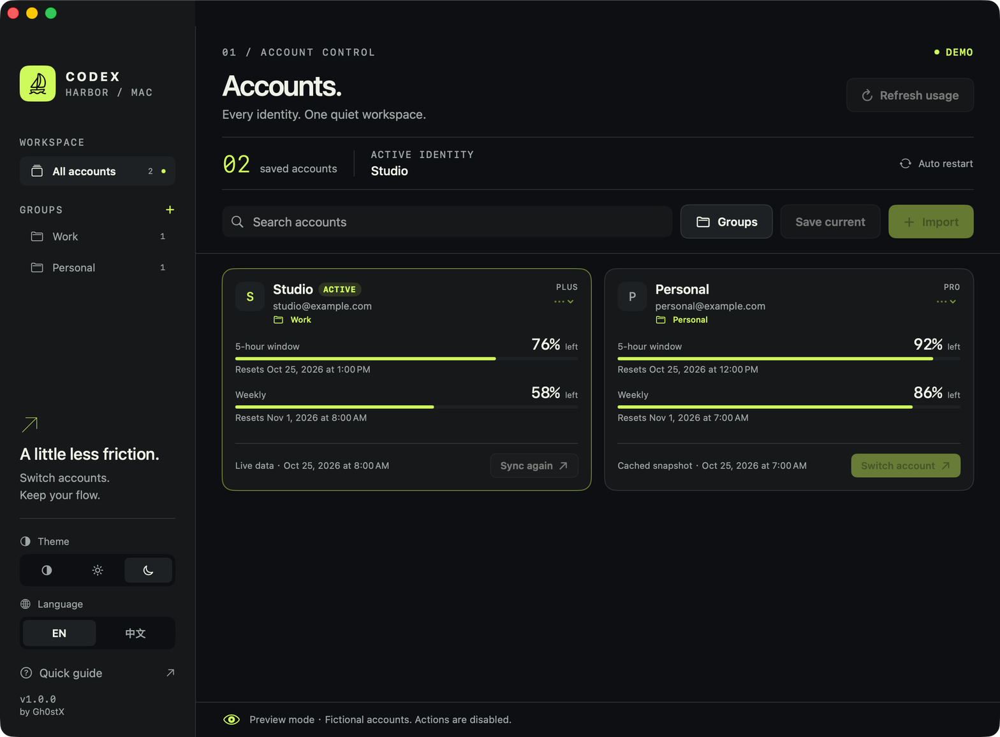

<div align="center">

# Codex Harbor

**Every identity. One quiet workspace.**

A desktop **Codex account manager** for macOS and Windows. It presents each account as a compact card, supports account groups, shows live or cached usage, and adapts to light or dark appearance.

Created by **Gh0stX**.

English · [简体中文](README.zh-CN.md)


</div>



*Screenshot uses fictional demo accounts. Account actions are disabled in demo mode.*

## What it does

- **A workspace that stays put.** The header, summary, search field, and group controls stay fixed; only the account cards scroll.
- **Compact cards, two per row.** Each card shows the account identity, plan, both usage windows, reset times, data source, and a direct switch action.
- **Account groups.** Create, rename, and delete groups. Drag a card onto a group in the sidebar, use **Move to group** from a card's menu, or assign accounts in the Groups sheet.
- **Usage you can read.** View short-window, weekly, and free-plan quotas with reset times, and distinguish live, local, and cached snapshots.
- **Switch and restart.** On macOS, apply a saved account, synchronize the background service, verify the local selection, and reopen Codex. On Windows, quit the client first, switch, then reopen Codex.
- **Bring your own sign-in.** Save the current Codex login or import an `auth.json` file or a folder of JSON files.
- **Light, dark, or system appearance.** Switch instantly from the sidebar or the Theme menu; the choice is remembered.
- **English and 简体中文.** English on first launch on macOS; Windows follows the system language. Instant switch and remembered preference.

## Requirements

| | Requirement |
| --- | --- |
| System | macOS 13 or later |
| Architecture | Apple Silicon; the bundled account core is arm64 |
| Codex | A separately installed Codex desktop app or CLI. macOS can restart the desktop app automatically; Windows requires a manual reopen. |
| Network | Required for live usage refresh and initial authentication |

The account core is bundled. Running the packaged app does not require Node.js or Zig.

Windows 10/11 x64 and Windows 11 on Arm are supported by the separate Windows builds below.

## Install

Download the latest release from the [Releases](../../releases/latest) page.

### macOS

1. Unzip `CodexHarbor-1.0.0-arm64.zip`.
2. Move **Codex Harbor.app** into **Applications**.
3. Open the app. Choose the appearance and language at the bottom of the sidebar.

The current build uses an ad-hoc signature and is **not notarized by Apple**. macOS may require you to review it in Privacy & Security. Developer ID signing and notarization are not included in the build script.

### Windows

The release assets include both architectures:

- `CodexHarbor-1.0.0-win32-x64-setup.exe` for Windows 10/11 x64.
- `CodexHarbor-1.0.0-win32-arm64-setup.exe` for Windows 11 on Arm.
- `CodexHarbor-1.0.0-win32-x64.zip` and `CodexHarbor-1.0.0-win32-arm64.zip` for portable use.

Run the installer for a guided per-user install, or unzip the portable build and run `Codex Harbor.exe`. The Windows builds are unsigned; Windows SmartScreen may ask you to confirm the app.

The Windows builds use the native x64 or arm64 account core and the same JSON interface. Closing the window offers **minimize to tray** or **quit**, and every launch refreshes live usage for all accounts once. The app syncs the current Codex login into its saved snapshot automatically at launch and before switching away, preserving cached usage. Quit Codex/ChatGPT and any Codex CLI sessions yourself before switching; Harbor does not close them for you. After switching, reopen Codex or use **Open Codex**. Do not use Codex's **Sign out** to switch accounts: it can revoke the saved login. If Codex asks you to sign in, sign in; the snapshot is synced automatically, or use **Save current** immediately. Account switching applies to Codex CLI and Codex App credentials; the ChatGPT desktop app keeps its own login and may ask you to sign in again. System proxy settings are read from the Windows Internet Settings registry. See [windows/README.md](windows/README.md) for details.

## Use

### Add an account

Sign in through Codex first, then choose **Save current**. Alternatively, use **Import** to select an `auth.json` file or a directory containing JSON files. Directory imports scan direct children only.

This app does not embed a login browser. New or revoked credentials must be obtained through Codex's login flow.

### Switch an account

Choose **Switch account**, review the dialog, then select **Switch & restart**. Finish your active work first: background synchronization and restarting Codex can interrupt attached tasks.

The app verifies the switch response and the local active-account record before restarting the desktop client. If switching or verification fails, it does not proceed with the desktop restart. If credentials were written but background synchronization failed, it reports the partial result and reloads the list. Use **Sync again** to retry the current account.

The app also syncs the current Codex login into its saved snapshot automatically at launch and before switching, preserving cached usage and aliases.

Restart uses a normal quit request. A declined quit or a 30-second exit timeout is reported without force-quitting the app. If Codex is not running, a successful switch opens it. Expired or revoked credentials can still require a new sign-in.

### Group accounts

Open **Groups** next to the search field to create, rename, or delete groups and to assign accounts with a picker. In the sidebar, click a group to filter the grid. Drag any card onto a group to move it there; drop it on **All accounts** to clear its group. Each card's menu also contains **Move to group**.

Groups are stored locally with the app. They do not change Codex credentials or the account registry.

### Read usage

**Refresh usage** (`⌘R`) requests online data. The app also refreshes live usage for all saved accounts once automatically at every launch. Each account shows its data source and snapshot time. On refresh failure, an older snapshot may remain visible; it is not presented as a newly verified online response. Live refresh reads the macOS system proxy settings, so it also works when the app is launched from Finder without the shell's proxy variables.

The selected identity describes local account-core state. A successful restart is not proof that every running session or remote environment has adopted that account.

### Appearance

Use the sun, moon, and half-circle buttons in the sidebar, or the **Theme** menu, to choose System, Light, or Dark. The preference is remembered between launches.

## Data and privacy

- Uses `CODEX_HOME` when inherited by the app process; otherwise the account core defaults to `~/.codex`.
- Credentials remain in local files managed by the account core. This app does **not** add Keychain encryption.
- The interface does not display raw access tokens, and account-core diagnostics are not persisted by the app.
- Live refresh uses authenticated network requests through the account core. This is not an entirely offline application.
- Account groups, appearance, and language preferences are stored locally by the app (macOS preferences; Windows local storage).
- Initial local listing can synchronize the current sign-in into the account registry.

Never include real authentication files, account registries, or tokens in issues, screenshots, or commits.

## Build and test

Install Xcode Command Line Tools, then run from the repository root on an Apple Silicon Mac:

```sh
./scripts/test.sh
./scripts/build.sh
```

The build produces:

```text
dist/Codex Harbor.app
dist/CodexHarbor-1.0.0-arm64.zip
```

The scripts use the bundled account core, generate the app icon, create the `.app` bundle, and apply an ad-hoc signature. `swift build` alone produces an executable without the bundled resources; use `build.sh` for a runnable app.

The Windows builds are produced separately:

```sh
cd windows
npm install
./scripts/build-windows.sh
```

They require Node.js 22+, npm, `zip`, and optionally `makensis` (`brew install makensis` on macOS). The build script writes both portable zips and, when `makensis` is available, both setup executables under `dist/`.

Tests cover JSON compatibility, localized errors and dates, language and theme preference fallback, quota calculation, switch-result validation, isolated account operations, and simulated restart ordering and failure paths. Account-core integration tests use a temporary `CODEX_HOME` and synthetic credentials. They do not restart your real Codex session or validate real online authentication.

For screenshots or UI review without accessing real accounts, quit Codex Harbor and run:

```sh
"dist/Codex Harbor.app/Contents/MacOS/CodexHarbor" --demo
```

Demo mode contains fictional accounts and groups, disables account operations and network refresh, and does not save preferences. Quit and reopen normally to return to your accounts.

See [development notes](docs/DEVELOPMENT.md) for source layout and packaging details, and [CHANGELOG](CHANGELOG.md) for version history.

## Scope

The current release does not include an embedded login browser, credential export, automatic updates, Intel macOS binaries, or experimental no-restart client injection. On macOS, automatic restart targets the local app with bundle identifier `com.openai.codex`, even when its visible name differs. Windows builds do not restart the client automatically.

## Credits and license

Codex Harbor is created by **Gh0stX** and is available under the [MIT License](LICENSE). It uses bundled third-party account cores under the MIT license; the required notices are retained in [`Vendor/core/LICENSE`](Vendor/core/LICENSE), [`windows/core/LICENSE`](windows/core/LICENSE), and in the application bundles. See [third-party notices](THIRD_PARTY_NOTICES.md).

This is an independent project, not an official OpenAI application or an affiliated service.
