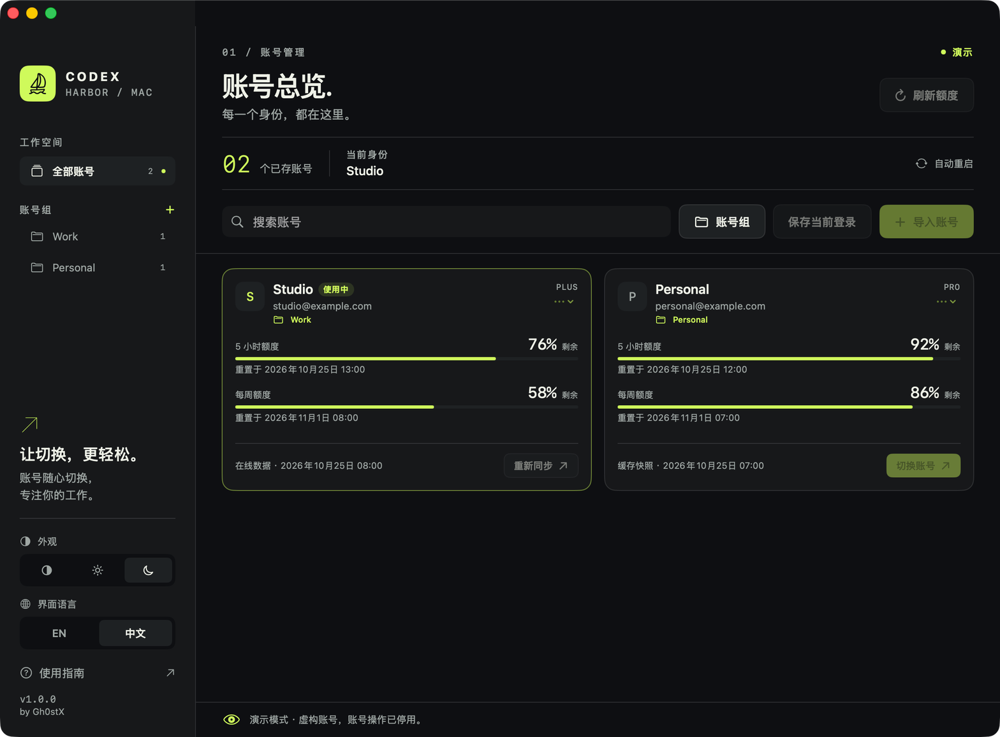

<div align="center">

# Codex Harbor

**每一个身份，都在这里。**

Codex Harbor 是一款用于 macOS 和 Windows 的 **Codex 账号管理工具**，每个账号以紧凑卡片呈现，支持账号组、在线或缓存额度，并适配浅色或深色外观。

作者：**Gh0stX**。

[English](README.md) · 简体中文


</div>



*截图使用虚构的演示账号。演示模式下账号操作不可用。*

## 功能

- **固定工作区**：页头、概览、搜索框和账号组控件保持固定，只滚动下方的账号卡片。
- **紧凑双列卡片**：每张卡片展示身份、套餐、两个额度窗口、重置时间、数据来源和切换按钮。
- **账号组**：创建、重命名、删除账号组。把卡片拖到侧栏的账号组，或在卡片菜单中选择**移动到账号组**，也可以在账号组面板中直接分配。
- **额度可视化**：显示短周期、每周和免费账号额度及重置时间，区分在线数据、本地会话和缓存快照。
- **切换后重启**：macOS 上写入目标账号凭据、同步后台服务、校验本地账号并自动重新打开 Codex；Windows 上请先退出客户端，切换后再重新打开。
- **保存与导入**：保存 Codex 当前登录，或导入 `auth.json` 文件及包含 JSON 的目录。
- **浅色 / 深色 / 跟随系统**：在侧栏或“外观”菜单即时切换，并记住选择。
- **中英文切换**：macOS 首次启动默认英文，Windows 首次启动跟随系统语言；可即时切换并记住选择。

## 环境要求

| 项目 | 要求 |
| --- | --- |
| 系统 | macOS 13 或更高版本 |
| 架构 | Apple Silicon；内置核心为 arm64 |
| Codex | 另行安装 Codex 桌面客户端或 CLI。macOS 可自动重启桌面客户端；Windows 需手动重新打开。 |
| 网络 | 在线刷新额度和首次登录需要网络 |

应用已内置账号管理核心，运行打包后的 App 不需要安装 Node.js 或 Zig。

Windows 10/11 x64 和 Windows 11 on Arm 由下面的独立 Windows 版本支持。

## 安装

从 [Releases](../../releases/latest) 页面下载最新版本。

### macOS

1. 解压 `CodexHarbor-1.0.0-arm64.zip`。
2. 将 **Codex Harbor.app** 拖入“应用程序”。
3. 打开应用，在侧栏底部选择外观和界面语言。

当前构建使用本地临时签名，**尚未经过 Apple 公证**。macOS 可能要求你在“隐私与安全性”中确认应用。构建脚本不包含 Developer ID 签名及公证流程。

### Windows

发布资产包含两个架构：

- `CodexHarbor-1.0.0-win32-x64-setup.exe`：适用于 Windows 10/11 x64。
- `CodexHarbor-1.0.0-win32-arm64-setup.exe`：适用于 Windows 11 on Arm。
- `CodexHarbor-1.0.0-win32-x64.zip` 和 `CodexHarbor-1.0.0-win32-arm64.zip`：免安装便携版。

运行安装包可按向导完成当前用户安装，或解压便携版后运行 `Codex Harbor.exe`。Windows 构建未签名，SmartScreen 可能要求确认。

Windows 版使用原生 x64 或 arm64 账号核心和同一套 JSON 接口。点击关闭按钮时可选择**最小化到托盘**或**退出**；每次启动会自动刷新一次所有账号的在线额度，并在启动时、切换离开当前账号前以及点击“保存当前登录”时，把当前 Codex 登录同步到账号快照，同时保留已缓存额度和别名。切换前请**手动退出 Codex/ChatGPT 和 Codex CLI 会话**，Harbor 不会替你关闭；切换后重新打开 Codex 或点击**打开 Codex**。**不要用 Codex 的“退出登录”来切换账号**：这可能吊销已保存的登录。如果 Codex 要求重新登录，请登录；快照会自动同步，也可以立即点击**保存当前登录**。账号切换作用于 Codex CLI 和 Codex App 凭据；ChatGPT 桌面客户端有自己的登录状态，可能需要重新登录。系统代理从 Windows Internet Settings 注册表读取。详细说明见 [windows/README.md](windows/README.md)。

## 使用

### 添加账号

先通过 Codex 完成登录，再点击**保存当前登录**。也可以点击**导入账号**，选择 `auth.json` 文件或包含 JSON 的目录。目录导入只扫描直接子文件，不递归扫描子目录。

应用不内嵌登录浏览器。新增登录或凭据被撤销后，需要通过 Codex 的登录流程重新授权。

### 切换账号

点击**切换账号**，阅读说明后选择**切换并重启**。请先完成正在进行的工作：后台同步和客户端重启可能中断当前任务。

应用会先校验切换返回的账号及重新读取的本地当前账号，再重启桌面客户端。切换或校验失败时，不继续执行桌面端重启。若凭据已经写入但后台同步失败，会明确提示部分成功，并重新加载列表。可点击当前账号的**重新同步**重试。

应用也会在启动时和切换前自动把当前 Codex 登录同步到账号快照，保留已缓存额度和别名。

重启使用正常退出请求。退出被拒绝或超过 30 秒时会提示，不强制结束进程。如果 Codex 原本未运行，切换成功后会打开它。已失效或被撤销的凭据仍可能需要重新登录。

### 账号组

点击搜索框后面的**账号组**按钮，可以创建、重命名、删除账号组，并用下拉菜单分配账号。在侧栏点击账号组可筛选卡片；把任意卡片拖到侧栏的账号组即可移动，拖到**全部账号**则清除分组。卡片菜单中也提供**移动到账号组**。

账号组保存在本机应用偏好中，不会修改 Codex 凭据或账号索引。

### 查看额度

点击**刷新额度**（`⌘R`）获取在线数据。应用每次启动时也会自动刷新一次所有已存账号的在线额度。每个账号分别显示数据来源及快照时间。刷新失败时可能保留旧快照，不会将其标记为本次在线查询成功。在线刷新会读取 macOS 系统代理设置，因此从访达启动、未继承终端代理变量时也能正常刷新。

当前身份代表本地核心的账号状态。客户端成功重启，不等于所有已有会话或远程环境都已验证采用新账号。

### 外观

使用侧栏的“跟随系统 / 浅色 / 深色”按钮，或菜单栏的**外观**菜单切换主题；选择会在下次启动时保留。

## 数据与隐私

- 应用进程继承 `CODEX_HOME` 时使用该目录，否则核心默认使用 `~/.codex`。
- 凭据沿用核心的本地文件存储方式，本应用**没有额外增加钥匙串加密**。
- 界面不显示原始访问令牌，也不持久化核心的诊断输出。
- 在线刷新会通过核心发送经过认证的网络请求，因此应用并非完全离线。
- 账号组、外观和语言偏好保存在应用本地存储中（macOS 偏好设置；Windows 本地存储）。
- 启动时读取本地列表，可能将当前登录同步到核心的账号索引。

请勿将真实凭据文件、账号索引或令牌放入 Issue、截图或代码提交中。

## 构建与测试

在 Apple Silicon Mac 上安装 Xcode Command Line Tools，然后在项目根目录执行：

```sh
./scripts/test.sh
./scripts/build.sh
```

构建输出：

```text
dist/Codex Harbor.app
dist/CodexHarbor-1.0.0-arm64.zip
```

脚本使用内置核心，生成应用图标和 `.app` 包，并进行本地临时签名。仅执行 `swift build` 得到的程序缺少打包资源，请使用 `build.sh` 生成可运行应用。

Windows 版本单独构建：

```sh
cd windows
npm install
./scripts/build-windows.sh
```

需要 Node.js 22+、npm、`zip`，以及可选的 `makensis`（macOS 上可用 `brew install makensis`）。构建脚本会在 `dist/` 下生成两个便携包；如果安装了 `makensis`，也会生成两个安装包。

测试覆盖 JSON 兼容性、中英文错误与日期、语言与主题偏好回退、额度计算、切换结果校验、隔离账号操作，以及模拟重启的顺序和失败路径。核心集成测试使用临时 `CODEX_HOME` 和虚构凭据，不会重启真实 Codex 会话，也不验证真实账号的在线认证。

需要截图或检查 UI 时，先退出 Codex Harbor，再启动演示模式：

```sh
"dist/Codex Harbor.app/Contents/MacOS/CodexHarbor" --demo
```

演示模式使用虚构账号和账号组，禁用账号操作与网络刷新，也不保存偏好。退出后正常打开应用即可返回真实账号列表。

项目结构及打包说明见[开发文档](docs/DEVELOPMENT.md)，版本记录见 [CHANGELOG](CHANGELOG.md)。

## 当前范围

当前版本不包含内嵌网页登录、凭据导出、自动更新、Intel macOS 发行包或实验性的免重启注入。macOS 上自动重启通过 `com.openai.codex` 标识定位本机客户端，不依赖应用的显示名称；Windows 版不会自动重新启动客户端。

## 致谢与许可证

Codex Harbor 由 **Gh0stX** 创建，使用 [MIT 许可证](LICENSE)。应用内置第三方账号核心，其 MIT 许可证要求的版权声明保留在 [`Vendor/core/LICENSE`](Vendor/core/LICENSE)、[`windows/core/LICENSE`](windows/core/LICENSE) 及应用包内，详情见[第三方声明](THIRD_PARTY_NOTICES.md)。

本项目为独立项目，并非 OpenAI 官方应用或关联服务。
